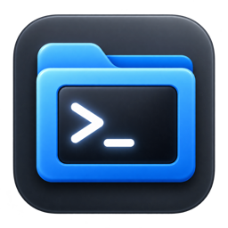
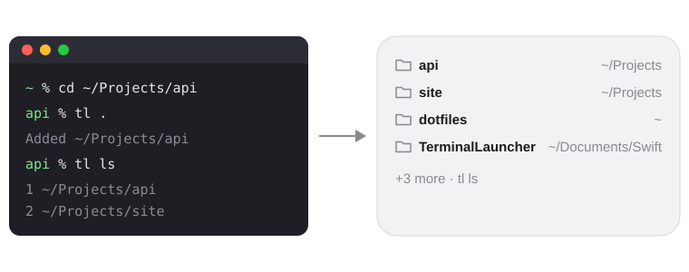

<div align="center">



# TerminalLauncher

**Your working folders on the macOS desktop. One click opens Terminal right there.**

[](https://github.com/alex-lemeshinsky/TerminalLauncher/releases)


[](LICENSE)



</div>

---

You keep `cd`-ing into the same handful of projects. TerminalLauncher puts them
in a desktop widget. Save a folder from the shell with `tl .`, and from then on
a click on the widget opens a new Terminal window already in that folder.

```bash
cd ~/Projects/api
tl .          # ~/Projects/api shows up in the widget a moment later
```

## Features

- 🗂 **Desktop widget** in small, medium and large sizes. Each size shows as
  many folders as fit, up to 10, and the newest come first.
- ⚡️ **One click to a shell.** A click on a row opens a new Terminal window in
  that folder.
- ⌨️ **A tiny CLI:** `tl .`, `tl ls`, `tl rm`. There are no settings screens.
- 🔗 **Symlinks stay as you see them.** `tl .` saves your shell's logical
  `$PWD`, not the resolved path.
- 🔒 **Safe URL scheme.** `tlaunch://open` only opens folders that are on your
  list, so a web page can't open Terminal windows wherever it likes.
- 🧪 **Tested core.** All the logic lives in a Swift package covered by
  Swift Testing suites.

> [!NOTE]
> TerminalLauncher is a personal project. It isn't on the App Store and isn't
> notarized, so you build it from source with your own Apple ID.

## Requirements

- macOS 27 or later
- Xcode 27, which includes Swift 6.4
- [XcodeGen](https://github.com/yonaskolb/XcodeGen): `brew install xcodegen`
- An Apple ID signed in to Xcode. A free Personal Team is enough.
- `~/.local/bin` on your `PATH`

## Install

1. Clone the repository:

   ```bash
   git clone https://github.com/alex-lemeshinsky/TerminalLauncher.git
   ```

2. **Set your own team ID.** The project ships with the author's team ID,
   `A5STTR22DU`. Replace it with yours in every file listed under
   [Signing](#signing). Your team ID is the **OU** field of your
   "Apple Development" certificate:

   ```bash
   security find-certificate -c "Apple Development" -p | openssl x509 -noout -subject
   ```

3. Build and install:

   ```bash
   scripts/install.sh
   ```

4. Add the widget: right-click the desktop → **Edit Widgets** → search for
   **TerminalLauncher** ("Terminal Folders") → pick a size.

<details>
<summary>What <code>install.sh</code> does</summary>

1. Generates the Xcode project.
2. Builds the Release configuration.
3. Stops any running copy of the app.
4. Installs `TerminalLauncher.app` to `~/Applications`.
5. Unregisters the copies in `build/` so `tlaunch://` links always reach the
   installed app.
6. Registers the installed copy with LaunchServices.
7. Links `~/.local/bin/tl` into the app bundle.
8. Launches the app once, so macOS registers the URL scheme and the widget.

Re-run the script after every change. It's safe to run more than once.

</details>

## Usage

| Command | What it does |
|---|---|
| `tl .` or `tl <path>` | Adds the folder at the top of the list. Adding a folder that's already listed moves it to the top. |
| `tl ls` | Prints the numbered list, newest first. Folders that no longer exist are marked `(missing)`. |
| `tl rm <n>` | Removes item number `n` from `tl ls`. |
| `tl rm <path>` | Removes a folder by path. This also works when the folder has been deleted from disk. |

```console
$ tl ls
 1  ~/Projects/api
 2  ~/Documents
 3  ~/old/thing   (missing)
$ tl rm 3
Removed ~/old/thing
```

- Paths are resolved against the current directory, and a leading `~` is
  expanded. Symlinks are kept the way you typed them (or, for `tl .`, the way
  your shell shows the current folder).
- Command names win over folder names. To add a folder called `ls`, `rm` or
  `3`, write `tl ./ls`.
- Errors go to stderr and exit with status 1. Running `tl` with no arguments
  prints the usage.

### The widget

- Each row shows the folder name and its parent folder, e.g. `api  ~/Projects`.
  The **small** size shows only folder names.
- When there are more folders than fit, the last row reads `+N more · tl ls`.
- **Clicking a row** opens a new Terminal window in that folder.
- **Clicking a deleted folder** shows an alert with the `tl rm` command that
  removes it.
- The widget updates right after `tl .` or `tl rm`. As a fallback, it also
  refreshes itself every 30 minutes.

## How it works

```
tl .  ──writes──▶  App Group container: paths.json  ◀──reads──  widget
 │                                  ▲                              │ click
 └── tlaunch://reload ──▶  TerminalLauncher.app  ◀── tlaunch://open?path=…
                             │                │
       WidgetCenter.reloadAllTimelines()     NSWorkspace → Terminal.app
```

- **`tl` (CLI)** is the only thing that writes the list, which lives at
  `~/Library/Group Containers/<TEAM_ID>.com.alex.TerminalLauncher/paths.json`.
  Each write is atomic. After every change, the CLI opens `tlaunch://reload` in
  the background.
- **TerminalLauncher.app** is a background agent: no Dock icon, no window, and
  not sandboxed. It handles two URLs:
  - `tlaunch://reload` refreshes the widget.
  - `tlaunch://open?path=…` opens Terminal at that path, but **only if the path
    is in the list**.
- **PathsWidget** is the sandboxed WidgetKit extension. It reads `paths.json`
  and turns each row into a `tlaunch://open` link.

<details>
<summary>The data file</summary>

```json
{
  "version": 1,
  "items": [
    { "path": "/Users/you/Documents", "addedAt": "2026-10-05T11:02:00Z" }
  ]
}
```

If the file can't be read, nothing overwrites it. The CLI reports the error and
the widget shows `Couldn't read list · run tl ls`. Fix the file or delete it to
start over.

</details>

## Project layout

```
project.yml                  XcodeGen definition: app, widget and CLI targets
App/                         Host app: URL handling, opening Terminal, alerts
Widget/                      WidgetKit extension: timeline provider and views
CLI/main.swift               Entry point for tl
Packages/LauncherKit/        All the logic, as a local Swift package
  Sources/PathStore/         Model, JSON store, path handling, tlaunch:// URLs,
                             click handling
  Sources/TLCommands/        tl commands and argument parsing
  Tests/                     Swift Testing suites
scripts/install.sh           Build and install
docs/superpowers/            Design spec, implementation plan, spike findings
```

`TerminalLauncher.xcodeproj` is generated by XcodeGen and is not committed.

## Development

Run the unit tests. They cover all the logic: storage, path handling, URLs,
click handling and the CLI commands.

```bash
cd Packages/LauncherKit && swift test
```

Build without installing:

```bash
xcodegen generate && xcodebuild -project TerminalLauncher.xcodeproj -scheme TerminalLauncher -configuration Debug -derivedDataPath build -allowProvisioningUpdates build
```

To work in Xcode, run `xcodegen generate` and open
`TerminalLauncher.xcodeproj`. The widget previews are in
`Widget/PathsWidgetView.swift`.

The app and the widget log to the unified log under the subsystem
`com.alex.TerminalLauncher`:

```bash
/usr/bin/log show --last 5m --predicate 'subsystem == "com.alex.TerminalLauncher"' --style compact
```

Use the full path `/usr/bin/log`, because in zsh `log` is a built-in command.

## Signing

The team ID `A5STTR22DU` is hard-coded in these files. Replace it in all of
them to build under your own team:

- `project.yml` (`DEVELOPMENT_TEAM`)
- `App/TerminalLauncher.entitlements` (App Group)
- `Widget/PathsWidget.entitlements` (App Group)
- `CLI/tl.entitlements` (App Group)
- `Packages/LauncherKit/Sources/PathStore/PathStore.swift` (`PathStore.appGroupID`)

The ID in brackets in the certificate's name is **not** the team ID; use the
**OU** field (see [Install](#install)).

Points that came up during the spike (details in
[`docs/superpowers/spikes/2026-10-05-app-group-findings.md`](docs/superpowers/spikes/2026-10-05-app-group-findings.md)):

- The App Group ID starts with the team ID. That lets the bare `tl` binary carry
  the App Group entitlement without a provisioning profile.
- `tl` is signed with `--identifier com.alex.TerminalLauncher.tl`. It is copied
  into `Contents/MacOS` with `codeSign: false`, so Xcode doesn't re-sign it
  under a different identifier.
- After you change any signing setting, run `rm -rf build` before building. An
  incremental build fails with "nested code is modified or invalid".
- Free Personal Team profiles expire after a while. If the app or the widget
  stops launching, run `scripts/install.sh` again.

## Troubleshooting

| Symptom | What to try |
|---|---|
| The widget doesn't update after `tl .` | Check that the app is running with `pgrep -x TerminalLauncher`. If `tl` warns `couldn't reach TerminalLauncher.app`, run `scripts/install.sh`. |
| A click does nothing | The path may not match the list exactly. Check `tl ls` and the log (see [Development](#development)). |
| TerminalLauncher is missing from Edit Widgets | Launch the app once with `open ~/Applications/TerminalLauncher.app`, then reopen Edit Widgets. |
| `tl: command not found` | Add `~/.local/bin` to your `PATH`. |

## Uninstall

1. Remove the widget from the desktop.
2. Remove the app and the CLI link:

   ```bash
   pkill -x TerminalLauncher; rm -rf ~/Applications/TerminalLauncher.app ~/.local/bin/tl
   ```

3. To also delete the saved list (use your team ID):

   ```bash
   rm -rf ~/Library/Group\ Containers/A5STTR22DU.com.alex.TerminalLauncher
   ```

## License

[MIT](LICENSE) © 2026 Oleksii Lemeshinskyi
